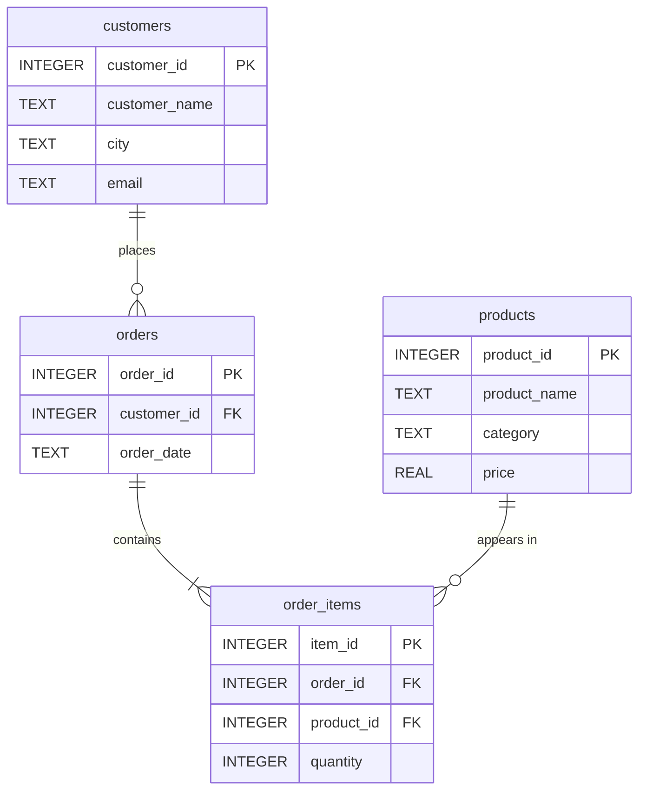

# 🛒 E-commerce Analysis Database

A compact **SQLite** database for exploring online-store data: who buys, what they buy, and when.


---

## 🗺️ Schema



| Table | What it holds |
|---|---|
| `customers` | Name, city and email of each shopper |
| `products` | Catalog with category and unit price |
| `orders` | One row per order, linked to a customer, with its date |
| `order_items` | Line items: which product, how many |

---

## 🚀 Quick start

```bash
sqlite3 ecommerce_analysis.db
```

**Revenue by category**
```sql
SELECT p.category,
       ROUND(SUM(oi.quantity * p.price), 2) AS revenue
FROM order_items oi
JOIN products p ON p.product_id = oi.product_id
GROUP BY p.category
ORDER BY revenue DESC;
```

**Top 10 customers by spend**
```sql
SELECT c.customer_name, c.city,
       ROUND(SUM(oi.quantity * p.price), 2) AS total_spent
FROM customers c
JOIN orders o       ON o.customer_id = c.customer_id
JOIN order_items oi ON oi.order_id   = o.order_id
JOIN products p     ON p.product_id  = oi.product_id
GROUP BY c.customer_id
ORDER BY total_spent DESC
LIMIT 10;
```

**Monthly orders**
```sql
SELECT strftime('%Y-%m', order_date) AS month,
       COUNT(*) AS orders
FROM orders
GROUP BY month
ORDER BY month;
```

---

## 💡 Ideas to explore

- Best-selling products and categories
- Repeat vs. one-time customers
- Sales by city
- Seasonality and monthly growth
- Average order value

---

## 📝 Notes

- Dates are stored as `TEXT`, so keep one consistent format (ISO `YYYY-MM-DD` works best with SQLite date functions).
- Foreign keys are declared; run `PRAGMA foreign_keys = ON;` to enforce them.
- A `.db-journal` file is SQLite's temporary rollback file. Keep it next to the `.db` file, and don't delete it by hand.
